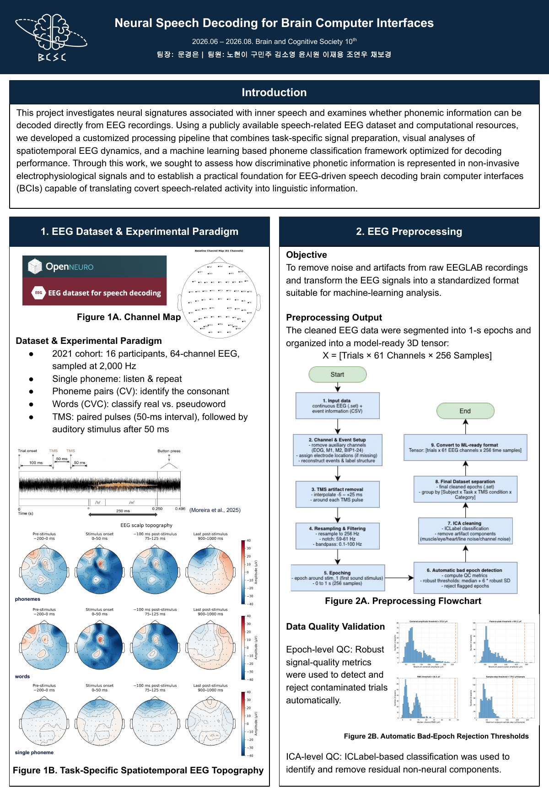
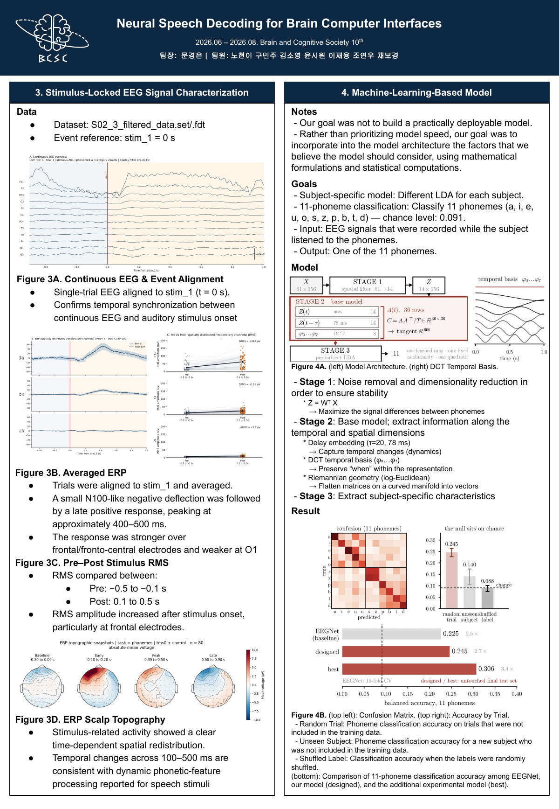

# Neural Speech Decoding from EEG

Portfolio archive of **Neural Speech Decoding for Brain-Computer Interfaces**, a Brain and Cognitive Society (BCSC) 10th cohort team project conducted from June to August 2026.

The project investigated whether phonemic information can be decoded from non-invasive EEG recorded during speech-listening tasks. It combines an EEGLAB preprocessing pipeline, stimulus-locked EEG characterization, and subject-aware machine-learning models for 11-phoneme decoding.

> **My verified contribution — Jaeyong Lee (이재용):** raw EEG preprocessing, the modeling idea, and the analysis/visualization presented as **Figure 3** in the final poster. The repository also preserves the complete team project for context; work outside those three areas is identified as team work rather than claimed as my individual implementation.

## Project at a glance

| Item | Detail |
|---|---|
| Dataset | OpenNeuro [`ds006104`, version 1.0.0](https://openneuro.org/datasets/ds006104/versions/1.0.0) |
| Cohort used | 16 participants from the 2021 cohort |
| Recording | 64-channel EEG sampled at 2,000 Hz; 61 scalp channels after auxiliary-channel removal |
| Tasks | single phoneme listen/repeat, consonant-vowel pair identification, real/pseudoword classification, and TMS conditions |
| Model input | `trials × 61 channels × 256 samples` (0–1 s, 256 Hz) |
| Main decoding task | 11 phonemes: `a, i, e, u, o, s, z, p, b, t, d` |
| Chance level | 0.091 for 11-way classification |

## My contribution

### 1. Raw EEG preprocessing

I worked on the pipeline that transforms raw EEGLAB recordings into model-ready arrays. The checked-in implementation includes:

1. structured event reconstruction from the experiment table;
2. removal of auxiliary channels (`EOG`, `M1`, `M2`, and `BIP1–BIP24`) and validation of channel locations;
3. TMS artifact interpolation from **−5 ms to +25 ms** around each pulse;
4. resampling to **256 Hz**, a **59–61 Hz notch filter**, and a **0.1–100 Hz band-pass filter**;
5. `stim_1`-locked epoching from **0 to 1 s**;
6. automatic bad-epoch detection using robust, subject-specific thresholds based on amplitude, peak-to-peak range, RMS, and sample-step metrics;
7. ICA with ICLabel-based artifact rejection at a conservative **0.90 probability threshold**;
8. task/condition/category separation and `.set → .mat → .npz` export.

Start with [`preprocessing_matlab/preprocessing_main.m`](preprocessing_matlab/preprocessing_main.m). Supporting functions are kept beside it so each validation and export step is inspectable.

### 2. Modeling idea

My role was in the **modeling idea**, not sole ownership of the complete modeling implementation. The team implementation represents each trial using spatial, delayed temporal, and low-frequency temporal-basis information:

```text
X: 61 channels × 256 samples
  → supervised SNR-oriented spatial projection: 61 → 14
  → A(t) = [Z(t), Z(t−20), φ0(t)…φ7(t)]
  → SPD covariance representation
  → log-Euclidean tangent-space projection
  → subject-specific Gaussian decision rule
  → one of 11 phoneme labels
```

The core idea was to preserve three complementary signals: spatial covariance, short-delay dynamics (20 samples, approximately 78 ms), and stimulus-locked temporal structure through a DCT basis. The repository distinguishes the interpretable designed model from the highest-performing concatenated ensemble; see [`model/model/README.md`](model/model/README.md) and [`model/SUMMARY.md`](model/SUMMARY.md).

### 3. Poster Figure 3

I produced the stimulus-locked analysis summarized in Figure 3:

- **3A — Continuous EEG and event alignment:** verified synchronization of single-trial EEG to `stim_1 = 0 s`.
- **3B — Averaged ERP:** aligned and averaged trials, showing a small N100-like negative deflection followed by a late positive response around **400–500 ms**.
- **3C — Pre/post RMS:** compared **−0.5 to −0.1 s** against **0.1 to 0.5 s**, with the strongest increase at frontal electrodes.
- **3D — ERP scalp topography:** visualized the redistribution of stimulus-related activity from **100 to 500 ms**.

Relevant scripts are in [`analysis/`](analysis/), especially [`figure1.py`](analysis/figure1.py), [`average_stage3_erp.py`](analysis/average_stage3_erp.py), and [`plot_stage3_erp_topomaps.py`](analysis/plot_stage3_erp_topomaps.py).

## Team modeling results

These are **team results**, included to describe the complete project rather than as an individual authorship claim.

| Model / evaluation | 11-phoneme balanced accuracy |
|---|---:|
| Designed main model, untouched final test set | 0.245 |
| Best concatenated representation, untouched final test set | **0.306** |
| Chance | 0.091 |
| Best model, leave-one-subject-out | 0.143 |

The important limitation is the gap between within-subject calibration and unseen-subject generalization. The 0.306 result describes new trials from participants whose calibration data were available; it must not be presented as performance on a completely unseen person. Detailed controls, null tests, and limitations are documented in [`model/SUMMARY.md`](model/SUMMARY.md).

## Final poster

[Download the original two-page poster (PDF)](assets/poster/BCSC_Neural_Decoding_Poster.pdf)





## Repository map

```text
.
├── preprocessing_matlab/   # Raw EEG → cleaned, epoched, ICA-reviewed data
├── analysis/               # QC, event alignment, ERP/RMS, and scalp topography
├── model/
│   ├── model/              # Main models and shared implementation
│   ├── attic/              # Exploratory and control experiments
│   ├── logs/               # Preserved experiment logs
│   └── slides/             # Team modeling deck and previews
├── assets/poster/          # Poster PDF and rendered previews
├── CONTRIBUTIONS.md        # Individual-vs-team contribution boundary
├── REPRODUCIBILITY.md      # Environment, data, and execution notes
└── README.original.md      # Original team repository README
```

## Reproducibility

The raw and processed EEG files are intentionally not stored in Git. Install the Python dependencies with:

```bash
python -m venv .venv
source .venv/bin/activate
python -m pip install -r requirements.txt
```

MATLAB preprocessing additionally requires EEGLAB and the ICLabel plugin. See [`REPRODUCIBILITY.md`](REPRODUCIBILITY.md) before running scripts; several archived experiments expect the original `npz2/` data layout.

## Attribution and scope

Team listed on the final poster: 문경은 (team lead), 노현이, 구민주, 김소영, 윤시원, 이재용, 조연우, 채보경.

This repository is a portfolio-oriented mirror of the team project, reorganized and documented by Jaeyong Lee. It preserves the project’s code and artifacts while explicitly limiting individual-credit claims to the contribution statement above. No raw participant EEG is included. See [`NOTICE.md`](NOTICE.md) for provenance and reuse notes.

